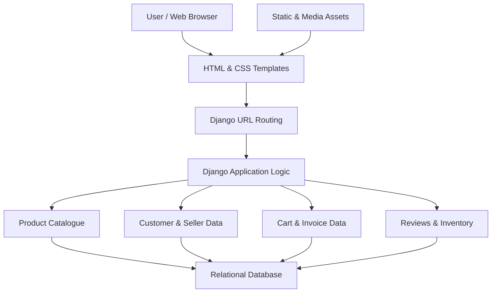
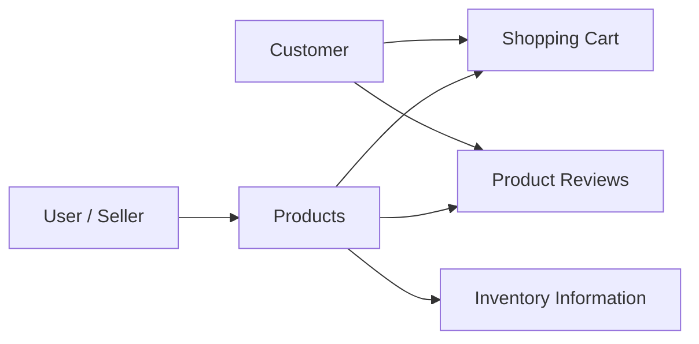

<div align="center">

<picture>
  <source
    media="(prefers-color-scheme: dark)"
    srcset="https://readme-typing-svg.demolab.com?font=Fira+Code&weight=700&size=28&duration=3000&pause=1000&color=36BCF7&center=true&vCenter=true&width=850&lines=E-Commerce+Website;Django+%7C+Python+%7C+SQL;Full-Stack+Web+Development"
  />
  <source
    media="(prefers-color-scheme: light)"
    srcset="https://readme-typing-svg.demolab.com?font=Fira+Code&weight=700&size=28&duration=3000&pause=1000&color=1764A0&center=true&vCenter=true&width=850&lines=E-Commerce+Website;Django+%7C+Python+%7C+SQL;Full-Stack+Web+Development"
  />
  
</picture>

### 🛍️ E-Commerce Website

**A Django-Based Online Shopping and Retail Management System**

*Web Development • Database Management • E-Commerce Architecture*

<br/>


<br/>


</div>

---

## 📖 Project Overview

**E-Commerce Website** is an academic
web development project built around
a Django-based online shopping system.

The project focuses on the design and
organization of a clothing-oriented
e-commerce platform, bringing together
product browsing, customer-facing pages,
seller-related interfaces, and
database-backed retail operations.

The available project files contain
templates and supporting assets for:

- Product listings and product details
- Shopping cart interfaces
- Customer login and profile pages
- Product reviews
- Inventory and stock views
- Invoice presentation
- Notifications
- Seller and customer information
- Product images and promotional content

The project demonstrates how a
server-side web framework, relational
database, and dynamic HTML templates
can be combined to structure an
online retail application.

> [!NOTE]
> The uploaded repository contains
> a partially preserved Django project.
> Several important application source
> files are absent from the available
> archive.
>
> This README documents the project
> structure and features represented
> in the supplied files. It does not
> claim that every feature has been
> independently executed or verified.

---

## 🎯 Project Objectives

The primary objectives are to:

- Design an online shopping interface.
- Organize product information for retail browsing.
- Develop reusable Django templates.
- Explore customer and seller data management.
- Represent shopping cart operations.
- Structure product review interfaces.
- Design inventory management views.
- Explore invoice generation workflows.
- Apply relational database concepts.
- Integrate frontend and backend web technologies.
- Understand the architecture of a database-driven website.

---

## ✨ Website Features

### 🛍️ Product Browsing

The project includes product-related
templates and sample database records
representing a clothing and accessories
catalogue.

The product data includes attributes
such as:

- Product name
- Price
- Discount
- Brand
- Size
- Category
- Product image
- Available quantity
- Seller identifier

These attributes form the basis of
the retail product catalogue.

### 🛒 Shopping Cart

The repository contains a dedicated
shopping cart template.

The available files also reference
cart-related database fields,
including total values and
sold-status information.

These components represent the
shopping cart portion of the
e-commerce workflow.

### 👤 Customer Accounts

The project includes templates for:

- Customer login
- User profile
- Profile editing
- Customer-related information

The supplied database notes also
include sample customer records.

### 🏪 Seller and Inventory Management

Seller-related records and product
ownership fields appear in the
database setup material.

The project includes a stock
management template for
inventory-related presentation.

### ⭐ Product Reviews

The repository includes templates
for viewing and editing reviews.

The database notes also reference
product reviews and rating-related
fields.

### 🧾 Invoice Presentation

Invoice-related templates are included
to represent transaction documentation.

The available files also contain
a dedicated invoice template.

### 🔔 Notifications

A notification page is included
among the project's HTML templates.

### 🖼️ Product Images and Banners

The archive contains media assets,
including product photographs and
carousel images.

These assets support the visual
presentation of the storefront.

---

## 🧩 Application Modules

<details>
<summary><b>🛍️ Product Catalogue Module</b></summary>

<br/>

The product-related files represent
the structure of a retail catalogue.

The available database examples
include fields for:

| Attribute | Purpose |
|:---|:---|
| Product ID | Product identifier |
| Name | Product name |
| Price | Selling price |
| Discount | Discount information |
| Brand | Product brand |
| Size | Available sizes |
| Category | Product classification |
| Image | Product photograph |
| Available Quantity | Inventory information |
| Seller ID | Associated seller |

The supplied sample products include
clothing and accessories such as
T-shirts, jeans, dresses, hoodies,
skirts, shoes, and belts.

</details>

<details>
<summary><b>👤 User Management Module</b></summary>

<br/>

The project includes user-related
templates and sample database entries.

The available data structures
represent attributes such as:

- User ID
- Username
- Email
- Phone number
- Password field
- Address
- Profile image

The repository also includes
login and profile-editing interfaces.

> The provided sample SQL contains
> plaintext example passwords.
> These examples should not be used
> as a production authentication system.

</details>

<details>
<summary><b>🛒 Shopping and Transaction Module</b></summary>

<br/>

The repository includes templates
for shopping cart and invoice views.

The project materials reference
cart totals, product associations,
and transaction-related information.

These files demonstrate the intended
structure of an online shopping
and purchase workflow.

</details>

<details>
<summary><b>📦 Inventory and Seller Module</b></summary>

<br/>

The project contains a stock
management template.

Database examples associate
products with seller identifiers
and available quantities.

These components represent
inventory and seller-related
retail operations.

</details>

<details>
<summary><b>⭐ Reviews and Notifications</b></summary>

<br/>

The available templates include:

- Product review
- Edit review
- Notification

The project also contains
review-related database examples
and migration references.

These components represent
customer feedback and
notification interfaces.

</details>

---

## 🏗️ Application Architecture

The project uses Django's
server-side web application
structure.



> This diagram illustrates the
> intended Django architecture.
> Some application logic files
> required to verify the complete
> request-handling flow are not
> present in the supplied archive.

---

## 🛠️ Technology Stack

| Category | Technology |
|:---|:---|
| Backend | Python, Django |
| Frontend | HTML, CSS |
| Template Rendering | Django Templates |
| Database | SQL, MariaDB/MySQL configuration |
| Database Interface | Django ORM architecture |
| Media Management | Django Media Files |
| Web Server | Django Development Server |
| Database Driver | mysqlclient |
| PDF Support | xhtml2pdf referenced in setup notes |

### Backend Development

The project uses Django to
structure the server-side
web application.

The available configuration
includes Django settings,
URL configuration, ASGI,
and WSGI files.

### Frontend Development

The frontend is organized
using HTML templates and
CSS assets.

The template directory
contains pages for the
storefront, shopping cart,
customer profile, inventory,
and other interfaces.

### Database Integration

The project materials reference
MariaDB/MySQL database setup
and Django model migrations.

The database configuration
is associated with a
clothing-oriented retail system.

---

## 🗃️ Database Design

The supplied SQL notes contain
example records and table references
for retail-related entities.

### Core Data Entities

| Entity | Purpose |
|:---|:---|
| User | Customer and seller information |
| Product | Product catalogue |
| Cart | Shopping cart and transaction data |
| Product Review | Customer feedback |
| Promotional Data | Promotional items and related information |

### Conceptual Data Relationships



This is a conceptual overview
of the available entities,
not a verified database
schema or complete
entity-relationship diagram.

---

## 📂 Repository Structure

The repository contains a
compressed Django project,
a Django management file,
database-related files,
and documentation.

### Root Repository

```text id="ecommroot"
E-Commerce-Website/
│
├── 471_Project-main.zip
├── manage.py
├── db.sqlite3
├── project
├── .gitattributes
└── README.md
```

### Contents of the Project Archive

```text id="ecomminner"
471_Project-main/
│
├── manage.py
├── db.sqlite3
├── project
│
├── shop/
│   ├── settings.py
│   ├── urls.py
│   ├── asgi.py
│   └── wsgi.py
│
├── webapp/
│   └── migrations/
│
├── templates/
│   ├── about.html
│   ├── base.html
│   ├── cart.html
│   ├── edit_review.html
│   ├── invoice.html
│   ├── invoice_template.html
│   ├── login.html
│   ├── notification.html
│   ├── product.html
│   ├── product_review.html
│   ├── stock.html
│   ├── user.html
│   └── user_edit_profile.html
│
├── static/
│   └── css/
│       └── login.css
│
└── media/
    ├── carousel/
    └── product images
```

The structure above summarizes
the principal project files.
Additional assets and compiled
Python files are also present
in the archive.

### Important File Descriptions

| File / Folder | Description |
|:---|:---|
| `manage.py` | Django management entry point |
| `shop/` | Django project configuration |
| `webapp/migrations/` | Available database migration files |
| `templates/` | Website page templates |
| `static/` | Static styling assets |
| `media/` | Product and carousel images |
| `project` | SQL setup notes and sample records |
| `471_Project-main.zip` | Archived Django project |

---

## 🚀 Installation and Setup

### Prerequisites

The original project is based on
the following technologies:

- Python 3
- Django
- MariaDB or MySQL
- mysqlclient
- xhtml2pdf
- A browser for viewing the application

### Step 1: Clone the Repository

```bash id="ecommclone"
git clone https://github.com/Shafin11/E-Commerce-Website.git
```

### Step 2: Open the Repository

```bash id="ecommcd"
cd E-Commerce-Website
```

### Step 3: Extract the Project

Extract the following file:

`471_Project-main.zip`

Open the extracted project directory
containing the Django configuration.

### Step 4: Create a Virtual Environment

```bash id="ecommvenv"
python -m venv .venv
```

Activate the environment.

**Windows:**

```powershell id="ecommwin"
.venv\Scripts\activate
```

**Linux / macOS:**

```bash id="ecommunix"
source .venv/bin/activate
```

### Step 5: Install Dependencies

```bash id="ecomminstall"
python -m pip install django mysqlclient xhtml2pdf
```

The supplied project does not
contain a complete dependency
lockfile. Additional packages
or version adjustments may
be required.

### Step 6: Review Database Configuration

The original project materials
reference a MariaDB/MySQL database.

Database setup notes are
included in the `project` file.

Before running the application:

- Review the Django database settings.
- Configure a local database.
- Replace hardcoded credentials.
- Avoid using the sample passwords.
- Check whether all required
  migration files are present.

### Step 7: Verify Project Completeness

The available archive does not
contain all of the application
source files needed to establish
a working Django installation.

In particular, important files
such as the application models,
views, and URL definitions
are absent.

These files must be recovered
or reconstructed before the
application can be reliably run.

> [!WARNING]
> The repository is provided as
> an archived academic project.
> The available files are not
> confirmed to form a complete,
> runnable application.
>
> Installation instructions
> describe the environment
> and setup requirements rather
> than a verified deployment process.

---

## 🔐 Security Considerations

The available project configuration
and SQL examples contain settings
that are not appropriate for
production deployment.

These include:

- A hardcoded Django secret key
- Debug mode enabled
- Example plaintext passwords
- Database credentials in setup notes

Before any public deployment,
these should be replaced with
secure environment-based settings
and properly managed credentials.

The application should not be
treated as production-ready
without further security review.

---

## 📚 Academic Background

This project was developed
as part of undergraduate
coursework at **BRAC University**.

**Course:** CSE471

**Project:** E-Commerce Website

**Project Category:** Database-Driven Web Application

**Application Domain:** Online Retail and Shopping

The project demonstrates
the integration of database
concepts, backend development,
and frontend interface design.

---

## 💡 Learning Outcomes

The project demonstrates
experience with:

- Python web development
- Django project architecture
- HTML template design
- CSS styling
- Database-driven applications
- SQL database concepts
- Product data organization
- Customer and seller interfaces
- Inventory data representation
- Shopping cart architecture
- Invoice templates
- Product review interfaces
- Static and media file management

---

## 📖 References and Resources

- [Django Documentation](https://docs.djangoproject.com/)
- [Python Documentation](https://docs.python.org/3/)
- [MariaDB Documentation](https://mariadb.com/docs/)
- [MySQL Documentation](https://dev.mysql.com/doc/)
- [MDN Web Docs](https://developer.mozilla.org/)
- [PyPI — mysqlclient](https://pypi.org/project/mysqlclient/)
- [xhtml2pdf Documentation](https://xhtml2pdf.readthedocs.io/)

---

<div align="center">

### 🛍️ Building Digital Shopping Experiences

*Exploring E-Commerce Architecture Through Python, Django, and SQL*

**CSE471 | BRAC University**

<br/>


</div>
